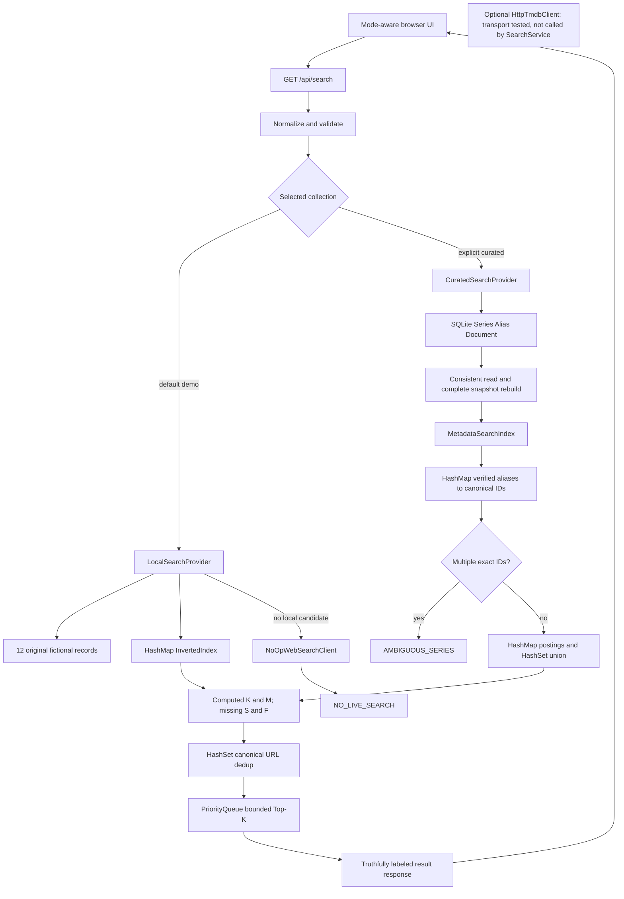

# Current implementation map and data-structure walkthrough

This describes actual implemented behavior on the feature PR chain, not the full planned live search engine.

GET /api/collection controls the UI banner/examples. Curated startup imports only a newly selected dedicated database and refuses existing contents that differ from the checked catalog. No result query performs external retrieval. Clicking a real curated link navigates to Wikipedia; that is distinct from the app querying a live search API.

## Structures that can be demonstrated

| Structure | Actual code | Role | Cost and limits |
|---|---|---|---|
| HashMap | InvertedIndex.postings/documentTerms | Term → matching IDs; document → existing terms for replacement/removal | Expected hash lookup O(1); add/replace/remove proportional to affected distinct terms |
| HashSet | postings sets, token sets, ResultMerger | OR union, unique terms, canonical URL dedup | Expected linear in input/posting entries; URL parsing also depends on URL length |
| LinkedHashSet | Tokenizer | Stable first-seen term sequence | Deduplicates query/document terms; CJK bigrams are lexical, not a full semantic segmenter |
| ArrayList | candidate/result assembly | Collect candidates and final sorted heap | O(N) storage before Top-K; ranking itself retains only min(N,K) heap rows |
| PriorityQueue | RankingAlgorithm | Retain highest scoring K candidates | O(N log(max(2,K))) expected comparison work, then O(K log K) output sort; O(min(N,K)) retained heap |
| HashMap of immutable sets | MetadataSearchIndex | Exact verified alias → all canonical IDs | Explicit ambiguity; no arbitrary winner on collisions |
| SQLite indexes | alias_lookup, document_series, unique constraints | Persistent identity/alias/provenance, repeatable load | Snapshot currently reads full collections; this is not a persisted inverted index |
| volatile immutable snapshot | MetadataSearchIndex | Readers retain a complete index while rebuilding | Rebuild requires a second complete snapshot in memory before publication |

OR search cost is O(query normalization/tokenization + queried posting entries + distinct result IDs), followed by scoring/dedup/Top-K over candidates. It does not scan all documents for a rare term. In a common-term query the posting list can still approach the whole corpus. The benchmark explicitly includes a brute-force baseline and small sets where scan overhead can be lower.

Current K/M derive from stored fields and aliases. S/F have no trustworthy independent source/date inputs and remain zero. The selected initial weights are not experimentally optimized. An exact curated title query commonly yields 75 because K=M=100 and S=F=0; the verification date is not treated as publication freshness.

## What is deliberately not claimed

No working live Web Search/TMDB lookup in SearchService, PTT/Dcard recall, general TV-vs-anime classifier, production language segmentation, AI fallback, course-mandated Tree/BFS, independent human quality study or final comparison result. Those require the documented dependencies/teacher rubric/credentials/permissions. See EXECUTION_BACKLOG.md for the remaining tasks.
